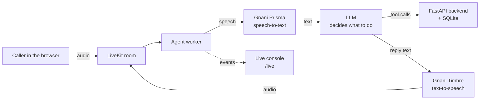

<div align="center">

# Aarogya Demo Clinic

### A Hindi voice receptionist that books clinic appointments by talking

*आरोग्य डेमो क्लिनिक: बोलकर अपॉइंटमेंट बुक कीजिए*


Built for the **Great Indian AI Internship Challenge 2026** by Gnani AI.

</div>

---

## What it is

Many small clinics lose patients because nobody picks up the phone. **Aarogya Demo Clinic** is a voice agent that takes the call instead. The caller speaks in Hindi, and the agent:

- tells them which doctors are available, with fees and timings,
- **books** an appointment,
- **reschedules** or **cancels** an existing one,
- passes billing or other questions to clinic staff as a **callback request**,
- sends anything that sounds like an emergency to **112**, and never gives medical advice.

Every change to the schedule is **repeated back and confirmed out loud** before the agent acts on it.

> **This is a demo. All doctors, patients, phone numbers and the clinic itself are made up.** No real personal data is used or stored.

## Demo

- Demo video: *add your LinkedIn post link here*
- Live console: while a call is running, `http://localhost:8000/live` shows what is said and which API calls happen, in a second window.

<!-- Add a screenshot or GIF here:

-->

## Gnani AI technology used

| Model | Used for | Where |
|---|---|---|
| **Gnani Prisma** | Speech-to-text: turns the caller's Hindi speech into text | `gnani.STT(language="hi-IN")` in `agent/agent.py` |
| **Gnani Timbre** (v2.5) | Text-to-speech: the agent's Hindi voice (male voice "Vikrant") | `gnani.TTS(...)` in `agent/agent.py` |

Both come from the [`livekit-plugins-gnani`](https://pypi.org/project/livekit-plugins-gnani/) plugin.

## How it works



1. The caller types a (fake) mobile number on the web page and presses **Start call**. The number goes to the agent as a LiveKit participant attribute, so the agent never has to catch digits by ear.
2. Audio flows through LiveKit to the agent. Silero VAD and LiveKit's multilingual turn detector decide when the caller has finished speaking.
3. Prisma turns the speech into text. The LLM reads it and calls tools (list doctors, get free slots, book, cancel, and so on).
4. The tools call the FastAPI backend, which owns the database and the clinic rules.
5. The LLM's reply is spoken by Timbre.

## Safety by design

A voice agent that changes real schedules should not act on a misheard word, so the agent is built to be careful:

- **Two-step actions.** `request_booking`, `request_cancel` and `request_reschedule` only *prepare* a change. A separate `confirm_pending_action` carries it out.
- **Confirm-after-question gate.** The confirmation counts only if the agent has asked the question *and* the caller answered afterwards. Pending changes expire after 3 minutes.
- **Whitelists.** The agent can only book slots and touch appointments that a tool offered to *this* caller in *this* call.
- **Emergency rule.** For chest pain, trouble breathing, heavy bleeding, fainting, stroke signs and similar, it does not book. It tells the caller to call **112** (and Tele-MANAS **14416** for thoughts of suicide).
- **Facts only from tools.** Doctors, fees, timings and the address come from the backend. The agent is told never to invent them, and never to say something is booked unless a tool result says so.
- **No medical advice.**

### Clinic rules enforced by the backend

- Booking needs at least 30 minutes of lead time.
- Cancel or reschedule needs at least 60 minutes of notice.
- At most 3 active appointments per phone number.
- A reschedule stays with the same doctor.
- A caller can only see and change their own appointments.
- Double-booking is blocked by a unique database index.

## Tech stack

| Layer | Technology |
|---|---|
| Speech-to-text | **Gnani Prisma** |
| Text-to-speech | **Gnani Timbre v2.5** |
| Call and agent runtime | LiveKit Agents 1.8, Silero VAD, LiveKit multilingual turn detector |
| LLM | `gpt-4.1-mini` through LiveKit Inference |
| Backend | Python, FastAPI, Pydantic v2, SQLite (WAL mode) |
| Frontend | Next.js 15, React 19, Tailwind CSS 4, LiveKit components |

## Project structure

```
.
├── agent/                 # the voice agent (LiveKit worker)
│   ├── agent.py           # instructions, tools, Gnani STT/TTS, safety gate
│   ├── requirements.txt
│   └── .env.example
├── backend/               # clinic API
│   ├── main.py            # FastAPI app and clinic rules
│   ├── live.py            # live console (/live)
│   ├── seed.py            # schema and fake data
│   ├── show_db.py         # print appointments, callbacks and the audit log
│   └── tests/test_api.py
└── frontend/              # Next.js web page for the call
    ├── app/
    └── components/app/    # welcome page and call view
```

## Run it locally

You need Python 3.10+, Node 20+, [pnpm](https://pnpm.io), a [LiveKit Cloud](https://cloud.livekit.io) project, and a Gnani API key.

### 1. Backend

```powershell
cd backend
python -m venv venv
venv\Scripts\activate
pip install -r requirements.txt
python seed.py                 # creates clinic.db with fake data
uvicorn main:app --reload
```

Check `http://127.0.0.1:8000/health`. The API docs are at `/docs` (click **Authorize** and enter `dev-clinic-key`).

### 2. Agent

```powershell
cd agent
python -m venv venv
venv\Scripts\activate
pip install -r requirements.txt
copy .env.example .env         # then fill in your keys
python agent.py download-files # one time: downloads the VAD and turn-detector models
python agent.py dev
```

`agent/.env`:

```
LIVEKIT_URL=wss://<your-project>.livekit.cloud
LIVEKIT_API_KEY=...
LIVEKIT_API_SECRET=...
GNANI_API_KEY=...
CLINIC_API_URL=http://localhost:8000
CLINIC_API_KEY=dev-clinic-key
```

### 3. Frontend

```powershell
cd frontend
copy .env.example .env.local   # fill in the LiveKit values
pnpm install
pnpm dev
```

Open `http://localhost:3000`, type a fake number (10 digits, starting with 6 to 9), press **Start call** and speak in Hindi. Open `http://localhost:8000/live` in a second window to follow the call.

To look at the stored data after a call:

```powershell
cd backend
python show_db.py
```

## Things to try

| Say (Hindi) | What should happen |
|---|---|
| "कौन से डॉक्टर हैं आपके पास?" | Lists the doctors from the database |
| "मुझे कल का अपॉइंटमेंट चाहिए" | Offers free times, asks your name, asks to confirm, then books |
| "मुझे अपॉइंटमेंट दूसरे समय पर करना है" | Offers other times with the same doctor, asks to confirm, then moves it |
| "मेरा अपॉइंटमेंट कैंसिल कर दीजिए" | Asks to confirm, then cancels |
| "मेरा बिल गलत आया है" | Offers a callback from staff and saves a request |
| "मेरे पिताजी को साँस लेने में बहुत तकलीफ़ हो रही है" | Tells you to call 112 and does not book |

## Testing

- **Backend:** API tests in `backend/tests/` (run `pip install -r requirements-dev.txt`, then `pytest`).
- **Voice flows:** tested by hand in live calls, covering doctor list, fees and address, booking, listing appointments, rescheduling, cancelling, callback request, the emergency reply, and the silence check (the agent asks twice if the caller is still there, then ends the call). The database and the audit log were checked after each call.

## Known limits

I would rather say these plainly:

- **Hindi only.** The speech-to-text writes English words in Devanagari, and the voice is a Hindi voice, so the agent always replies in Hindi even when spoken to in English.
- **Runs locally.** It is not deployed, and the database is SQLite.
- **No real login.** Any visitor can start a call. The caller's number is typed in and not verified (no OTP). A real version would verify it.
- **One clinic, one language, fixed demo doctors.**
- **Latency** is about 2 to 3 seconds for a plain reply and about 3 to 5 seconds when a tool is called.
- Timbre v2.5 is in beta, so voice quality may change.
- The LLM can occasionally phrase things unexpectedly. The safety gate keeps it from changing the schedule without a confirmation, but the wording is not guaranteed.

## Acknowledgements

Thanks to **Gnani AI** for the Prisma and Timbre models and for the Great Indian AI Internship Challenge, and to the [LiveKit](https://livekit.io) team for LiveKit Agents and the starter template this front end grew from.

## Author

**Mohd Ali**
B.Tech CSE student, Maharaja Surajmal Institute of Technology 
Email - mohdalisaad868@gmail.com
GitHub: [@BeingMohdAli](https://github.com/BeingMohdAli)
